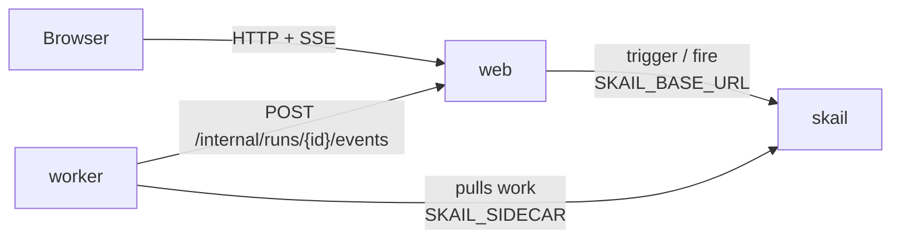

# skail USD quote (.NET 8)

[Português (Brasil)](README.pt-BR.md)

A skail function fetches the US dollar quote, waits 30 seconds with a durable delay and fetches again. It keeps going until you press **Stop** or it reaches 20 quotes (about 10 minutes), and a web page shows each quote as it arrives.

The demo covers three topics of the [skail docs](https://docs.skail.dev) (in Portuguese):

- a [durable delay](https://docs.skail.dev/referencia/sdk-csharp/delay) that survives a worker restart;
- an [external event](https://docs.skail.dev/referencia/sdk-csharp/waitforevent) that stops the run in the middle of a wait;
- the [wait with a deadline](https://docs.skail.dev/construa/como-fazer/esperar-um-evento-com-prazo) pattern: the event or the delay, whichever comes first.

## How it works



- **worker** (`src/SkailUsdQuote.Worker`): the function `TrackUsdQuote(runId, currency)` and its commands. `FetchQuote` gets the quote and records when it fetched it; `ReportQuote`, `ReportStopped`, `ReportCompleted` and `ReportFailure` send the progress to the web app.
- **web** (`src/SkailUsdQuote.Web`): static page and API. It starts a run (trigger), stops it (fire), keeps the run state in memory and streams it to the page (SSE).
- **contracts** (`src/SkailUsdQuote.Contracts`): types and constants shared by the worker and the web app.

The function only orchestrates and leaves the I/O to the commands. It creates one wait for `STOP_TRACKING` and reuses it in every `WhenAny` against the 30-second delay. Simplified from [`QuoteFunctions.cs`](src/SkailUsdQuote.Worker/QuoteFunctions.cs), which also reports a failed fetch to the page:

```csharp
var stopEvent = SkailTask.WaitForEvent(Events.StopTracking, runId);

for (var quoteNumber = 1; quoteNumber <= QuoteLimits.MaxQuotes; quoteNumber++)
{
    var quote = await commands.FetchQuote(currency);
    await commands.ReportQuote(runId, quoteNumber, quote);
    if (quoteNumber == QuoteLimits.MaxQuotes) break;

    var interval = SkailTask.DelaySeconds(QuoteLimits.IntervalSeconds);
    if (await SkailTask.WhenAny(stopEvent, interval) == stopEvent)
    {
        await commands.ReportStopped(runId, quoteNumber);
        return new RunResult(quoteNumber, RunEnd.Stopped);
    }
}
```

The page has a currency list (Real, Euro, Yuan, Yen; Real is the default), locked while a run is active, and a single button that toggles between **Start** and **Stop**.

## How it connects to skail

| Service | Variable | Used for |
|---|---|---|
| worker | `SKAIL_SIDECAR` | Connects the function to your environment and receives its work. |
| web | `SKAIL_BASE_URL` | Starts and stops runs through the skail HTTP API. |

Both use the same `SKAIL_WORKLOAD`, `SKAIL_NAMESPACE` and `SKAIL_KEY`. The web app makes two calls:

```http
POST {SKAIL_BASE_URL}/api/v1/trigger/{name}/{version}/TrackUsdQuote/{runId}
["{runId}", "{currency}"]

POST {SKAIL_BASE_URL}/api/v1/fire/STOP_TRACKING/{runId}
{}
```

`{name}` and `{version}` come from `SKAIL_WORKLOAD` (`name:version`). Each call sends the key in `skail-key` and in `Authorization: Bearer`, plus the `Skail-namespace` header, as described in [authentication](https://docs.skail.dev/referencia/api-http/autenticacao). `429`, `5xx` and network errors are retried with the same run id. `401` and `403` are not retried: check `SKAIL_KEY` and `SKAIL_NAMESPACE`.

The browser never calls skail. It only talks to the web app, so the key stays on the server.

## Requirements

- .NET 8 SDK
- podman or docker
- PowerShell 7+ (`pwsh`), only if you use `scripts/run.ps1` instead of `scripts/run.sh`
- A skail environment with the workload from `SKAIL_WORKLOAD` registered (`usdquote:v1.0.0` by default). The [Quickstart](https://docs.skail.dev/comece-aqui/quickstart) shows how to get an account, create the environment and register the workload.
- A current browser (Chrome/Edge 111+, Firefox 113+, Safari 16.2+). The page uses Server-Sent Events, CSS `color-mix()` and modern JavaScript.

## Configure

```bash
cp .env.example .env     # .env holds the key and is ignored by git
```

Fill in `SKAIL_WORKLOAD` (exactly as registered in the portal), `SKAIL_NAMESPACE`, `SKAIL_KEY`, `SKAIL_SIDECAR` and `SKAIL_BASE_URL` with the values of your environment.

## Run with podman or docker

```bash
scripts/run.sh up        # builds both images and starts web + worker
scripts/run.sh logs
scripts/run.sh down
```

`CONTAINER_ENGINE=docker` forces docker. On Windows, or anywhere with PowerShell 7+, run `pwsh scripts/run.ps1 <command>` with the same commands; `$env:CONTAINER_ENGINE = "docker"` forces docker.

Open <http://localhost:8080>, pick a currency and press **Start**.

Each quote in the table has two times. **Fetched at** is when the function fetched the quote, every 30 seconds. **Source time** is when AwesomeAPI published that rate. The source publishes a new rate only every few minutes, so consecutive fetches can show the same rate and the same source time.

### See the durability

1. Press **Start** and wait for the first quote.
2. During the 30-second wait, run `scripts/run.sh restart`. It restarts only the worker; the web app keeps the page state.
3. The next quote arrives on schedule, handled by the restarted worker: **Fetched at** keeps the 30-second interval.
4. Press **Stop** at any time, even in the middle of a wait. The function wakes up and ends without another fetch.

In the portal, open the [Monitor](https://docs.skail.dev/referencia/portal/monitor) of your environment and click the run. Each quote shows up as `FetchQuote` and `ReportQuote`, each wait as a `WhenAny` with its `Delay`, and the stop as `ReportStopped`. The `WaitForEvent` for `STOP_TRACKING` shows up once, at the top, because the function creates that wait at the start and reuses it.

Compare **Duration** with **E2E Duration**. In a run of 3 quotes, the run took 1 min 22 s and the worker processed for less than 1 s, because the waits do not use the worker. A run you stop also shows as **Completed**, because the function returns normally; the result it returns says how it ended (`End: Stopped`).

## VS Code

Open the folder and accept the recommended extensions (C# Dev Kit).

- `Ctrl+Shift+B` builds, the *test* task runs the tests and the `containers: up/down/logs` tasks call `scripts/run.sh`.
- The **Worker + Web** debug configuration starts both projects reading `.env`, and a breakpoint inside a command works. Outside containers the worker reaches the web app on `localhost` (`WEB_BASE_URL`, set in `launch.json`).

## Tests

```bash
dotnet test
```

The unit tests cover the contracts, the quote providers, the progress notifier, the run state, the Start/Stop rules, the calls to skail (trigger, fire and retries) and the web API. They need neither network nor skail.

## Notes

- `QUOTE_PROVIDER=fake` runs without internet, with simulated quotes. The default provider is AwesomeAPI, which may answer `429`; skail retries the command.
- Stop is idempotent: pressing it twice, or after the run ended, has no effect.
- The run history lives in skail. The page state lives in memory and is lost when the web app restarts.
- `POST /internal/runs/{id}/events`, which the worker calls to report progress, has no authentication. That is fine for a local demo; protect it before using the pattern in production.
- Workers running the same `SKAIL_WORKLOAD` on the same environment share the same runs: use one workload (or environment) per person.

## License

[Apache-2.0](LICENSE)
