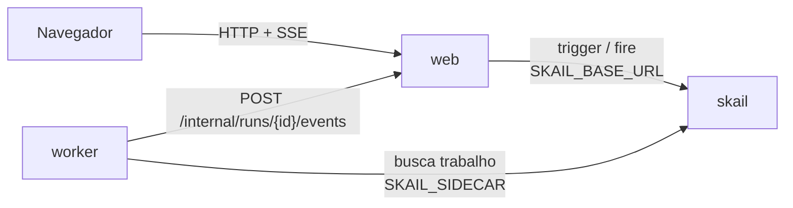

# skail USD quote (.NET 8)

[English](README.md)

Uma function do skail consulta a cotação do dólar, espera 30 segundos com um delay durável e consulta de novo. Ela continua até você clicar em **Stop** ou chegar a 100 cotações, e uma página web mostra cada cotação assim que ela chega.

A demo mostra três tópicos da [documentação do skail](https://docs.skail.dev):

- um [delay durável](https://docs.skail.dev/referencia/sdk-csharp/delay), que sobrevive ao reinício do worker;
- um [evento externo](https://docs.skail.dev/referencia/sdk-csharp/waitforevent), que para a execução no meio de uma espera;
- o padrão de [espera com prazo](https://docs.skail.dev/construa/como-fazer/esperar-um-evento-com-prazo): o evento ou o delay, o que vier primeiro.

## Como funciona



- **worker** (`src/SkailUsdQuote.Worker`): a function `GetUsdQuote(runId, currency)` e os commands `FetchQuote` e `Notify`.
- **web** (`src/SkailUsdQuote.Web`): página estática e API. Inicia a execução (trigger), para a execução (fire), guarda o estado em memória e transmite para a página (SSE).
- **contracts** (`src/SkailUsdQuote.Contracts`): tipos e constantes usados pelo worker e pelo web.

A function só orquestra e deixa o I/O para os commands. Ela cria uma única espera por `STOP_QUOTE` e reaproveita essa espera em todos os `WhenAny` contra o delay de 30 segundos. O trecho abaixo é uma versão simplificada do [`QuoteFunctions.cs`](src/SkailUsdQuote.Worker/QuoteFunctions.cs), que também avisa a página quando a consulta falha:

```csharp
var stopEvent = SkailTask.WaitForEvent(Events.StopQuote, runId);

for (var i = 1; i <= QuoteLimits.MaxIterations; i++)
{
    var quote = await commands.FetchQuote(currency);
    await commands.Notify(runId, RunStage.Quoted, i, quote, null);
    if (i == QuoteLimits.MaxIterations) break;

    var interval = SkailTask.DelaySeconds(QuoteLimits.IntervalSeconds);
    if (await SkailTask.WhenAny(stopEvent, interval) == stopEvent)
    {
        await commands.Notify(runId, RunStage.Stopped, i, quote, null);
        return new RunResult(i, RunEnd.Stopped);
    }
}
```

A página tem uma lista de moedas (Real, Euro, Yuan e Iene, com Real como padrão), que fica bloqueada enquanto há uma execução ativa, e um único botão que alterna entre **Start** e **Stop**.

## Como conecta ao skail

| Serviço | Variável | Para quê |
|---|---|---|
| worker | `SKAIL_SIDECAR` | Conecta a function ao seu environment e recebe o trabalho dela. |
| web | `SKAIL_BASE_URL` | Inicia e para execuções pela API HTTP do skail. |

Os dois usam os mesmos `SKAIL_WORKLOAD`, `SKAIL_NAMESPACE` e `SKAIL_KEY`. O web faz duas chamadas:

```http
POST {SKAIL_BASE_URL}/api/v1/trigger/{nome}/{versao}/GetUsdQuote/{runId}
["{runId}", "{currency}"]

POST {SKAIL_BASE_URL}/api/v1/fire/STOP_QUOTE/{runId}
{}
```

`{nome}` e `{versao}` vêm de `SKAIL_WORKLOAD` (`nome:versao`). Cada chamada manda a chave em `skail-key` e em `Authorization: Bearer`, mais o header `Skail-namespace`, como descrito em [autenticação](https://docs.skail.dev/referencia/api-http/autenticacao). `429`, `5xx` e erros de rede são repetidos com o mesmo run id. `401` e `403` não são repetidos: confira `SKAIL_KEY` e `SKAIL_NAMESPACE`.

O navegador nunca chama o skail. Ele só fala com o web, então a chave fica no servidor.

## Requisitos

- SDK do .NET 8
- podman ou docker
- PowerShell 7+ (`pwsh`), só se você usar o `scripts/run.ps1` em vez do `scripts/run.sh`
- Um environment do skail com o workload de `SKAIL_WORKLOAD` cadastrado (`usdquote:v1.0.0` por padrão). O [Quickstart](https://docs.skail.dev/comece-aqui/quickstart) mostra como pedir a conta, criar o environment e cadastrar o workload.
- Um navegador atual (Chrome/Edge 111+, Firefox 113+, Safari 16.2+). A página usa Server-Sent Events, `color-mix()` do CSS e JavaScript moderno.

## Configurar

```bash
cp .env.example .env     # o .env guarda a chave e é ignorado pelo git
```

Preencha `SKAIL_WORKLOAD` (exatamente como está cadastrado no portal), `SKAIL_NAMESPACE`, `SKAIL_KEY`, `SKAIL_SIDECAR` e `SKAIL_BASE_URL` com os valores do seu environment.

## Rodar com podman ou docker

```bash
scripts/run.sh up        # builda as duas imagens e sobe web + worker
scripts/run.sh logs
scripts/run.sh down
```

`CONTAINER_ENGINE=docker` força o docker. No Windows, ou em qualquer sistema com PowerShell 7+, rode `pwsh scripts/run.ps1 <comando>` com os mesmos comandos; `$env:CONTAINER_ENGINE = "docker"` força o docker.

Abra <http://localhost:8080>, escolha a moeda e clique em **Start**.

### Ver a durabilidade

1. Clique em **Start** e espere a primeira cotação.
2. Durante a espera de 30 segundos, rode `scripts/run.sh restart`. Ele reinicia só o worker, e o web mantém o estado da página.
3. A próxima cotação chega no horário, processada pelo worker reiniciado.
4. Clique em **Stop** a qualquer momento, até no meio de uma espera. A function acorda e termina sem fazer outra consulta.

No portal, abra o [Monitor](https://docs.skail.dev/referencia/portal/monitor) do seu environment para ver cada passo da execução: cada `FetchQuote` e `Notify`, cada delay e o evento `STOP_QUOTE`.

## VS Code

Abra a pasta e aceite as extensões recomendadas (C# Dev Kit).

- `Ctrl+Shift+B` compila, a task *test* roda os testes e as tasks `containers: up/down/logs` chamam o `scripts/run.sh`.
- A configuração de debug **Worker + Web** sobe os dois projetos lendo o `.env`, e um breakpoint dentro de um command funciona. Fora de container, o worker acessa o web em `localhost` (`WEB_BASE_URL`, definido no `launch.json`).

## Testes

```bash
dotnet test
```

Os testes unitários cobrem os contratos, os providers de cotação, o notificador de progresso, o estado das execuções, as regras dos botões Start e Stop, as chamadas ao skail (trigger, fire e novas tentativas) e a API web. Eles não precisam de rede nem do skail.

## Observações

- `QUOTE_PROVIDER=fake` roda sem internet, com cotações determinísticas. O provider padrão é a AwesomeAPI, que pode responder `429`; nesse caso o skail repete o command.
- O Stop é idempotente: clicar duas vezes, ou depois que a execução terminou, não tem efeito.
- O histórico da execução fica no skail. O estado da página fica em memória e se perde quando o web reinicia.
- O `POST /internal/runs/{id}/events`, que o worker chama para avisar o progresso, não tem autenticação. Para uma demo local isso basta; proteja esse endpoint antes de usar o padrão em produção.

## Licença

[Apache-2.0](LICENSE)
