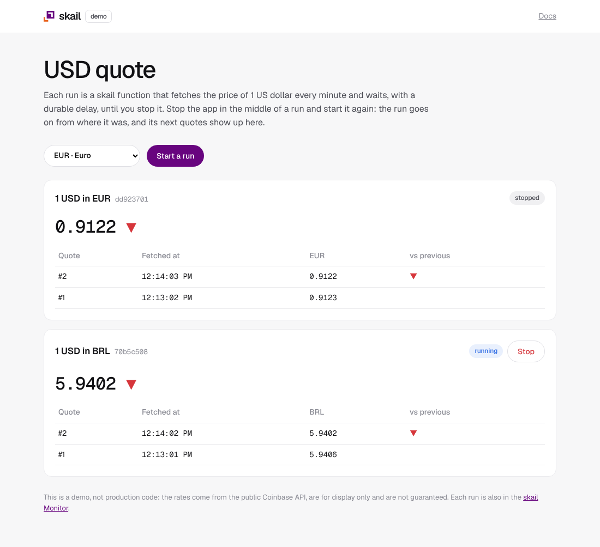

# skail USD quote (.NET 8)

[English](README.md)

Um app com uma function do skail que busca a cotação do dólar, espera um minuto com um delay durável e busca de novo, até você parar. Você inicia e para as execuções numa página que o app serve em http://localhost:8080.

Ele mostra três recursos do skail:

- um **delay durável**: feche o app no meio de uma espera, abra de novo e a execução continua de onde estava;
- um **evento externo** (`STOP_TRACKING`) que para a execução no meio de uma espera;
- **novas tentativas automáticas**: quando a API de cotação falha, o skail tenta de novo sozinho.

## Requisitos

- Um destes: [Docker](https://docs.docker.com/get-docker/), [Podman](https://podman.io/docs/installation) ou o [SDK do .NET 8](https://dotnet.microsoft.com/download/dotnet/8.0) (ou mais novo). O script de execução usa o primeiro que encontrar.
- Um environment do skail com um workload registrado para o `SKAIL_WORKLOAD` do `.env` (`usdquote:v1.0.0` por padrão). O [Quickstart](https://docs.skail.dev/comece-aqui/quickstart) mostra como criar a conta, o environment e o workload.

O projeto usa o `Skail.Platform.Runtime` **2.3.0-rc.4**.

## Rodar

```bash
cp .env.example .env  # preencha SKAIL_SIDECAR, SKAIL_NAMESPACE e SKAIL_KEY (portal > Environments & keys > Connect)
scripts/run.sh        # depois abra http://localhost:8080
```

No Windows, no PowerShell: `copy .env.example .env` e depois `powershell -ExecutionPolicy Bypass -File scripts\run.ps1`. O script funciona no Windows PowerShell que já vem no Windows; não precisa do PowerShell 7.

O script roda a demo com o que a máquina tiver: Docker, depois Podman, depois o SDK do .NET. Se não achar nenhum, ele diz o que instalar. Sem o script, os comandos são `dotnet run`.



| O que você clica | O que acontece |
|---|---|
| uma moeda (BRL, EUR, CNY ou JPY) e depois **Start a run** | uma nova execução busca 1 USD nessa moeda agora e depois uma vez por minuto |
| **Stop** numa execução | o app dispara o `STOP_TRACKING`; a execução termina durante a espera atual |

Cada cotação mostra quando foi buscada e se subiu (▲), caiu (▼) ou ficou igual (=) em relação à anterior. Dá para rodar várias moedas ao mesmo tempo. A página se atualiza sozinha a cada segundo, e cada cotação também aparece no console.

## Como funciona

O app faz três coisas no mesmo processo: serve a página, hospeda o worker que executa a function (`builder.UseSkail()`) e inicia e para as execuções pela API HTTP do skail:

```http
POST {SKAIL_SIDECAR}/api/v1/trigger/usdquote/v1.0.0/TrackUsdQuote/{runId}
["{runId}", "BRL"]

POST {SKAIL_SIDECAR}/api/v1/fire/STOP_TRACKING/{runId}
{}
```

A function, em [`QuoteFunctions.cs`](QuoteFunctions.cs):

```csharp
[SkailFunction(retryCount: 0)]
public async SkailTask<int> TrackUsdQuote(string runId, string currency)
{
    var stopEvent = SkailTask.WaitForEvent(Events.StopTracking, runId);

    for (var quoteNumber = 1; ; quoteNumber++)
    {
        var quote = await FetchQuote(currency);
        await ReportQuote(runId, quoteNumber, quote);

        var interval = SkailTask.DelaySeconds(IntervalSeconds);
        if (await SkailTask.WhenAny(stopEvent, interval) == stopEvent)
        {
            await ReportStopped(runId, quoteNumber);
            return quoteNumber;
        }
    }
}
```

- A function só orquestra. Cada vez que a execução acorda (depois de um delay, de um evento ou de um reinício do app), o skail roda a function de novo desde o começo (replay).
- O I/O fica nos commands: o `FetchQuote` chama a API de cotação, e o `ReportQuote` e o `ReportStopped` entregam o resultado à página. Um command que terminou nunca roda de novo, então um replay não busca de novo nem mostra a mesma cotação duas vezes.
- A espera pelo `STOP_TRACKING` é criada uma vez e reaproveitada em todo `WhenAny` contra o delay de um minuto: o que vier primeiro vence.

| Arquivo | O que tem |
|---|---|
| `QuoteFunctions.cs` | A function e os commands dela. |
| `Quotes/CoinbaseQuoteProvider.cs` | A chamada às cotações da Coinbase. |
| `Demo/QuoteDesk.cs` | Inicia e para as execuções da página e guarda as cotações que cada uma informou. |
| `Page/index.html` | A página, com a marca do skail. |
| `Skail/SkailApiClient.cs` | Trigger e fire pela API HTTP do skail. |
| `Program.cs` | Lê o `.env`, serve a página e a API dela, e liga tudo. |
| `scripts/run.sh`, `scripts/run.ps1`, `Dockerfile` | Rodam a demo com Docker, Podman ou o .NET, o que houver na máquina. |

## Veja a durabilidade

1. Rode `scripts/run.sh`, abra a página, inicie uma execução e espere a primeira cotação.
2. Durante a espera de um minuto, aperte **Ctrl+C**. O app fecha; a execução continua no skail, esperando.
3. Rode `scripts/run.sh` de novo e abra a página. O skail entrega ao app a execução que estava esperando: a próxima cotação chega no horário, numerada depois da última, e a execução aparece na página com ela. As cotações de antes do reinício estavam na memória do app que fechou, então não aparecem na página. Clique em **Stop** para terminar a execução.

No portal, abra o [Monitor](https://docs.skail.dev/referencia/portal/monitor) do seu environment e clique na execução: cada cotação aparece como `FetchQuote` e `ReportQuote`, cada espera como um `WhenAny` com o seu `Delay`, e a parada como `ReportStopped`.

## Quando a API de cotação falha

As cotações vêm da API pública de câmbio da Coinbase, que não precisa de chave. Quando ela não responde, ou responde com erro (um `429` por excesso de requisições, um `5xx`), o `FetchQuote` lança exceção, e o skail tenta de novo com uma espera crescente (15 s, 30 s, 1 min, 2 min, 4 min), até 5 vezes (`[SkailCommand(retryCount: 5)]`). A página espera enquanto isso; no Monitor, o `FetchQuote` mostra cada tentativa. Se a API não voltar a tempo, a execução termina como Failed no Monitor (`retryCount: 0` na function).

## Observações

- Uma execução não tem limite: continua até você parar. Pare as execuções que iniciar, para que não fiquem rodando no seu environment.
- Apps rodando o mesmo `SKAIL_WORKLOAD` no mesmo environment dividem as mesmas execuções: use um workload (ou environment) por pessoa.

## Aviso

**Esta é uma demonstração, não é código de produção.** Ela existe só para mostrar como o [skail](https://docs.skail.dev) funciona e é fornecida "como está", sem garantia de nenhum tipo. Ela usa uma API gratuita de terceiros (as cotações da Coinbase), que pode mudar, limitar ou recusar requisições a qualquer momento. As cotações são só para exibição: não use para nenhuma decisão.

## Licença

[Apache-2.0](LICENSE)
